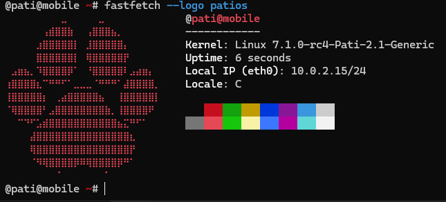

# PatiOS - A distribution built on Linux for ARM64.
[](https://ibm.com)
[](#)

[]()

**PatiOS** is a Linux From Scratch (LFS) distribution that runs on the Linux kernel, with core system components—such as the system manager and service utilities—written entirely in C.

* **codename:** `şakir` (shakir)


## Compiling Instructions
* **Install the *Prerequisites* from your package manager or the internet**
* **Obtain the fish-shell from https://github.com/fish-shell/fish-shell**
* **Put in the same folder where the source code is located**
* **Type `sudo make` and let the magic happen :)**

## Prerequisites
* **aarch64-linux-musl-gcc** (Makefile already installs it)
* **qemu-system-aarch64** package (`qemu-system-arm`)
* **unzip** package
* **genext2fs** package
* **sfdisk** package (`fdisk` / `util-linux`)
* **e2fsprogs** package (`mkfs.ext4`, `debugfs`, `tune2fs`, `e2fsck`)
* **cpio** package
* **gzip** package
* **findutils** package (`find`)
* **file** package
* **cargo** package
* **rustc** package
* **jsonschema** package (must be installed with `pip`)
* **jinja2** package (must be installed with `pip`)

## Technical Features

PatiOS doesn't uses any Debian / Ubuntu like rootfs. It has own rootfs and user-space tools.

* **Standalone User-Space:** It doesn't needs any Python Interpreter or any heavy translator in itself. It uses binaries compiled in C & Rust
* **Musl-libc Optimization:** Compiled targeting the `aarch64-linux-musl-gcc` chain. This results in a smaller binary size compared to the standard `glibc` libraries.

---

## Project Content and File Structure

* `Makefile` : Compiler for PatiOS
* `pati-commands/` : It's own services and programs.
* `rootfs/` : It's own rootfs
* `thirdparty/` : Third-party software (like coreutils)
* `assets/` : screenshots, other files etc.

---

## Installation and supported platforms

### Supported Platforms
* Raspberry Pi 3 / 4 / 5 (ARM64)
* QEMU (Virtualization)
* WSL (Windows Subsystem for Linux) and native Linux Distros

### Installation Steps (Raspberry Pi 3/4/5) 
1. Partition your SD card using the **MBR** layout and create a partition with a minimum size of **512MB in FAT32**.
2. Copy the contents of the `boot` folder from the [Raspberry Pi Firmware](https://github.com/raspberrypi/firmware) repository to this partition.
3. Rename the `initramfs` file you compiled to `initramfs.gz` and upload it to the FAT32 partition.
4. Create a `cmdline.txt` file and add the following parameters:
   `console=serial0,115200 console=tty1 rdinit=/init`
5. Create a `config.txt` file and save the system with the following example parameters:
   ```text
   display_auto_detect=1
   initramfs initramfs.gz followkernel
   disable_fw_kms_setup=1
   arm_64bit=1
   arm_boost=1
   ```

---

## Screenshots from the system
 
  
 

---

## License and Contributions

This project is released under the **GPL v3** license. 
* Provided that all copyrights to the project remain intact, it is entirely free to use in commercial and institutional projects, whether as a standalone solution or integrated into other systems.
* To contribute to the project or report a bug, you can open an issue via the **Issues** tab.

**Development Note:** This project is being developed using a protocol focused on research and in-depth engineering. Rather than directly copying code while using artificial intelligence, we are prioritizing operating system theory, terminology research, and low-level logical reasoning.

## Things will be added soon:
- LTE 4G Modem /dev/pts/X (Python)
- AT Command Manager (Rust)
- Things that users want =)

## Timeline:
1. March 27, 2026 - Repo created (under the name “Pati”)
2. April 11, 2026 - First official release
3. May 9, 2026 - Transition to version 2.1 and the “Ananas” codename
4. May 19, 2026 - Special release commemorating the May 19 Atatürk Commemoration, Youth, and Sports Day
5. July 2, 2026 - 2.6 Release
6. November 16, 2026 - PatiOS-3.0 released

---
*Developer: [mehmetdemir-tr](https://github.com/mehmetdemir-tr)*
